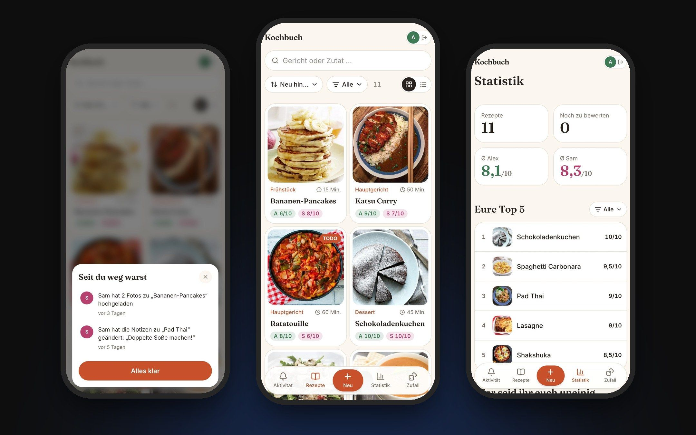
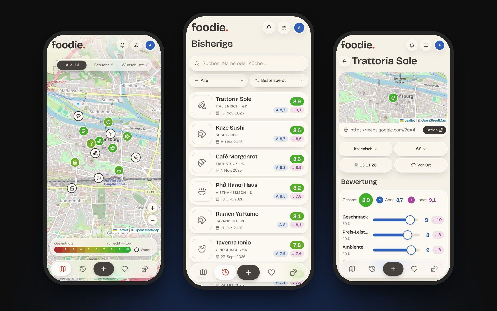
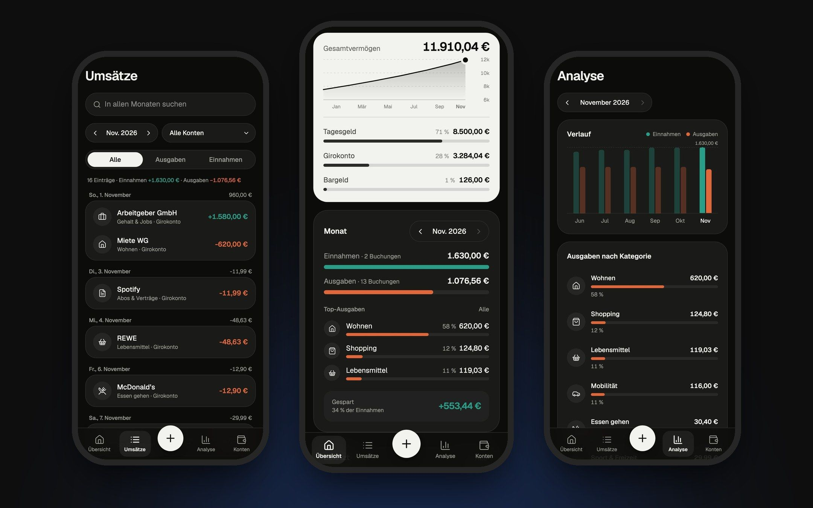

<p align="center">
  <a href="https://portfolio.websbybenny.de">
    
    
    
  </a>
</p>

<h1 align="center">Benny Herdt – Portfolio</h1>

<p align="center">
  <a href="https://portfolio.websbybenny.de"></a>
  
  
</p>

My personal portfolio: who I am, my CV, and the projects I build. This repo holds only the portfolio itself – every project lives in its own repository.

## ✨ Projects

| Project | What it is | Live | Code |
|---|---|---|---|
| **Webs by Benny** | My web agency for local businesses, with an automated demo-to-deploy pipeline | [websbybenny.de](https://websbybenny.de) | private |
| **Kochbuch** | Recipe PWA with photos, per-person ratings and push notifications (Next.js, Postgres, Web Push) | [case study](https://portfolio.websbybenny.de/kochbuch) | [herdtbenny/kochbuch](https://github.com/herdtbenny/kochbuch) |
| **Foodie** | Restaurant app for two: wishlist, weighted ratings, Google-Maps import and a map (Next.js, Leaflet) | [case study](https://portfolio.websbybenny.de/foodie) | [herdtbenny/foodie](https://github.com/herdtbenny/foodie) |
| **Finanzboard** | Mobile household-budget PWA with standing orders and in-browser receipt OCR (React, Supabase) | [case study](https://portfolio.websbybenny.de/finanzboard) | [herdtbenny/finanzboard](https://github.com/herdtbenny/finanzboard) |
| **xG Lab** | Interactive expected-goals model: place shots, get live goal probabilities and the "deserved" result | [xg-lab.websbybenny.de](https://xg-lab.websbybenny.de) | [herdtbenny/xG-lab](https://github.com/herdtbenny/xG-lab) |
| **Sport Scorings** | Live tables, matchdays and top scorers for Bundesliga, Premier League & more via the OpenLigaDB API | [sport-scorings.websbybenny.de](https://sport-scorings.websbybenny.de) | [herdtbenny/sport-scorings](https://github.com/herdtbenny/sport-scorings) |

The case-study pages show the private apps (Kochbuch, Foodie, Finanzboard) with screenshots on invented demo data, since the real apps sit behind a login.

## 🛠️ Tech

React 19 · React Router · Tailwind CSS (CSS-variable themes, dark by default with a light toggle) · Vercel Analytics · Playwright screenshot script for project previews

## 🚀 Run locally

```bash
npm install
npm start                   # dev server on http://localhost:3000
npm run build               # production build
npm run screenshot:projects # re-capture the screenshots of the public projects
```

Project cards are defined in [`src/projects/projectData.js`](src/projects/projectData.js); the CV section mirrors [`public/Lebenslauf_DE.pdf`](public/Lebenslauf_DE.pdf).

---

<p align="center">Built by <a href="https://github.com/herdtbenny">Benny Herdt</a> · Regensburg 🇩🇪</p>
