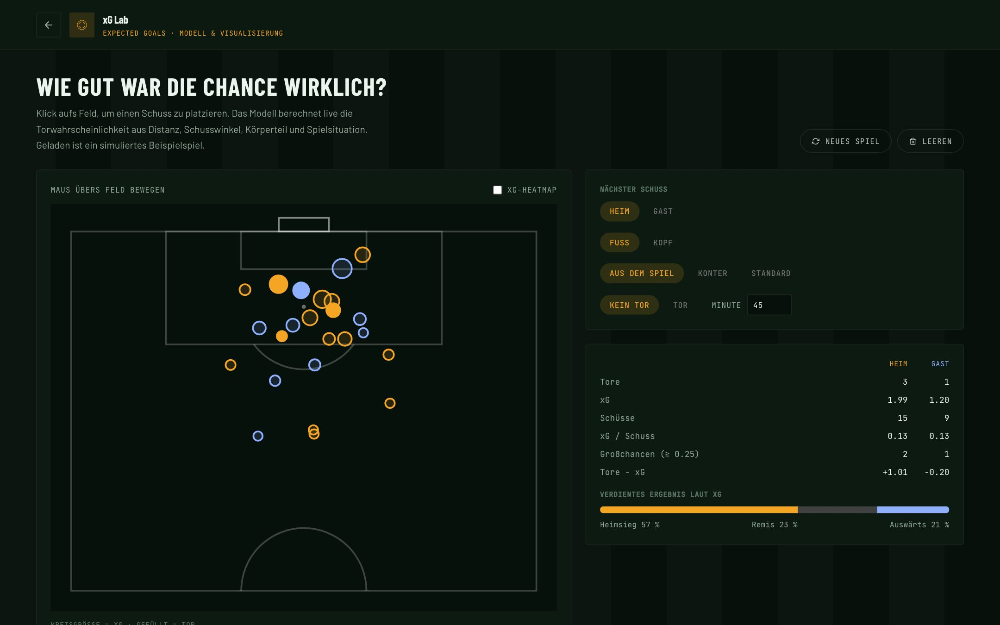
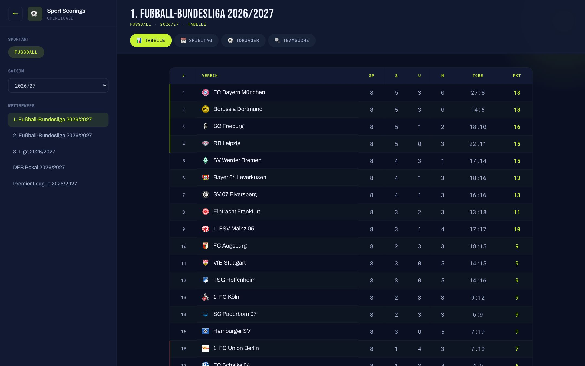
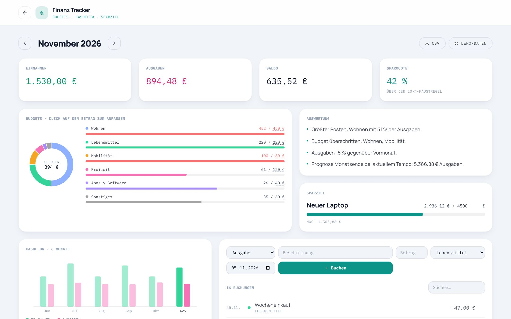

<p align="center">
  <a href="https://portfolio.websbybenny.de">
    
    
    
  </a>
</p>

<h1 align="center">Benny Herdt – Portfolio</h1>

<p align="center">
  <a href="https://portfolio.websbybenny.de"></a>
  
  
</p>

My personal portfolio: who I am, what I build, and interactive demos of my projects – right in the browser.

## ✨ What's inside

| Project | Type | Try it |
|---|---|---|
| **xG Lab** | Interactive expected-goals model – place shots on the pitch, get live goal probabilities and the "deserved" result | [/xg-lab](https://portfolio.websbybenny.de/xg-lab) |
| **Sport Scorings** | Live tables, matchdays and top scorers for Bundesliga, Premier League & more via a public REST API | [/sportScorings](https://portfolio.websbybenny.de/sportScorings) |
| **Finanz Tracker** | Budgets, cash flow and savings goals with automatic month-end forecast | [/finance-tracker](https://portfolio.websbybenny.de/finance-tracker) |
| **Auth & Rollen-System** | RBAC playground with real signed JWTs (HMAC-SHA256, Web Crypto), editable permission matrix and transparent middleware | [/auth-rollen-system](https://portfolio.websbybenny.de/auth-rollen-system) |
| **Kochbuch** | Full-stack recipe app (Next.js, Postgres, Web Push) – [source](https://github.com/herdtbenny/kochbuch) | [/kochbuch](https://portfolio.websbybenny.de/kochbuch) |
| **Webs by Benny** | My web agency for local businesses, with an automated demo-to-deploy pipeline | [websbybenny.de](https://websbybenny.de) |

## 🛠️ Tech

React 19 · React Router · Tailwind CSS · SVG charts · Web Crypto API · Vercel Analytics · Playwright screenshot script for project previews

## 🚀 Run locally

```bash
npm install
npm start                  # dev server on http://localhost:3000
npm run build              # production build
npm run screenshot:projects # re-capture project screenshots
```

Project cards are defined in [`src/projects/projectData.js`](src/projects/projectData.js).

---

<p align="center">Built by <a href="https://github.com/herdtbenny">Benny Herdt</a> · Regensburg 🇩🇪</p>
